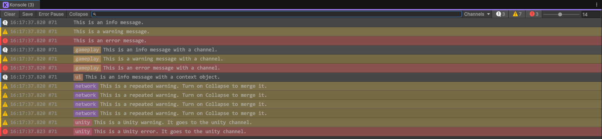

# Konsole

A channel-based log API and an editor console window for Unity.



- **Channels.** Tag each log with a free string (`"save"`, `"ads"`, `"level"`). Show or hide channels from one menu.
- **Clean builds.** `Info` and `Warning` calls are removed from player builds by the compiler. They cost nothing on a device.
- **Crash-tool safe errors.** `Error` stays in builds, but it never calls `Debug.LogError`. Crashlytics and similar tools capture `Debug.LogError` as a crash report.
- **One place for all logs.** Unity warnings, errors, exceptions and compiler messages also show in the window, in the `unity` channel.
- **Fast to read.** Search, collapse, severity toggles, a stack trace panel with clickable frames, and an adjustable font size.

## Install

### Package Manager (recommended)

1. Open **Window > Package Manager**.
2. Click **+ > Add package from git URL...**
3. Paste this URL and click **Add**:

```
https://github.com/cpeakdot/Konsole.git
```

To lock a version, add a tag to the URL:

```
https://github.com/cpeakdot/Konsole.git#v1.0.0
```

You can also add the line to `Packages/manifest.json`:

```json
"com.cpeakdot.konsole": "https://github.com/cpeakdot/Konsole.git#v1.0.0"
```

### .unitypackage

1. Download `Konsole_1.0.0.unitypackage` from [Releases](https://github.com/cpeakdot/Konsole/releases).
2. In Unity, select **Assets > Import Package > Custom Package...** and select the file.

The files go to `Assets/Plugins/Konsole`.

### Requirements

- Unity 6 (`6000.0`) or newer. Older versions are not tested.
- No other packages.

## Quick start

```csharp
using Cpeakdot.Logging;
using UnityEngine;

public class SaveSystem : MonoBehaviour
{
    private void Start()
    {
        Konsole.Info("save", "Profile loaded");
        Konsole.Warning("save", "Cloud save is off", this);
        Konsole.Error("save", "Save file is corrupt. Default profile used");
    }
}
```

Open the window with **Tools > Konsole**.

## Log API

All methods are in the static class `Konsole` (namespace `Cpeakdot.Logging`).

| Method | In player builds | Unity Console output |
|---|---|---|
| `Konsole.Info(message, context = null)` | Removed | `Debug.Log` |
| `Konsole.Info(channel, message, context = null)` | Removed | `Debug.Log` |
| `Konsole.Warning(message, context = null)` | Removed | `Debug.LogWarning` |
| `Konsole.Warning(channel, message, context = null)` | Removed | `Debug.LogWarning` |
| `Konsole.Error(message, context = null)` | Kept | `Debug.Log` with an `[ERROR]` prefix |
| `Konsole.Error(channel, message, context = null)` | Kept | `Debug.Log` with an `[ERROR]` prefix |

- **channel**: any string. No setup is necessary. A log with no channel shows as `(none)` in the Channels menu.
- **context**: an optional `UnityEngine.Object`. Click the row to select and ping it in the Hierarchy or Project window.
- Each call also writes to the Unity Console as `[channel] message`.

### Why `Info` and `Warning` are removed from builds

These methods have `[Conditional("UNITY_EDITOR")]`. The C# compiler removes the call and the arguments from any build without `UNITY_EDITOR`.
For example, `Konsole.Info("level", "Loaded " + levelName)` makes no string and no allocation on a device.

### Why `Error` does not use `Debug.LogError`

Crash reporters such as Firebase Crashlytics capture every `Debug.LogError` as a non-fatal issue.
A known and harmless error then fills your crash dashboard.
`Konsole.Error` uses `Debug.Log` with an `[ERROR]` prefix. The prefix is red in the editor and plain text in device logs, so you can still find it with `adb logcat` or Xcode.

## The Konsole window

Open it with **Tools > Konsole**.

### Toolbar

| Control | What it does |
|---|---|
| **Clear** | Removes all rows. |
| **Save** | Writes the visible rows to a text file. |
| **Error Pause** | Pauses play mode when an error row arrives. |
| **Collapse** | Merges rows with the same severity, channel and message. The row shows a count. |
| **Search** | Shows only rows whose message contains the text. |
| **Channels** | Shows or hides each channel. **Show all** shows every channel. |
| **Info / Warning / Error** | Shows or hides each severity. The numbers are the totals of all rows, also hidden rows. |
| **Font size** | Sets the row font size, from 9 to 20. |

### Rows and stack traces

- **Click** a row to select it and its context object. The bottom panel shows the full message and the stack trace.
- **Double-click** a row to open the first stack frame that has a source file.
- **Right-click** a row to copy the message, or the message and the stack trace.
- **Click** a stack frame in the bottom panel to open the file at that line.
- If the list is scrolled to the bottom, it follows new rows.

### The `unity` channel

Logs that do not come from `Konsole.*` go to the `unity` channel:

- `Debug.LogWarning` makes a warning row.
- `Debug.LogError`, exceptions and failed asserts make an error row.
- Compiler errors and warnings make a row with the file and line. A new compile replaces them.
- Plain `Debug.Log` makes no row.

This channel is hidden by default. Select it in the **Channels** menu to see it.

## Behaviour notes

- Rows survive a script reload. They are not saved to disk.
- Rows are cleared when you enter play mode.
- The window keeps at most 10,000 rows. When it is full, it removes the oldest rows down to 9,000.
- Hidden rows still count in the totals. A hidden `unity` error still triggers **Error Pause**.
- Logs from any thread are safe. The window shows them on the next editor update.
- Code that compiles without `UNITY_EDITOR` loses its `Info` and `Warning` calls. This is also true for some editor tools that compile code at runtime.

## Advanced: listen to log entries

`Konsole.OnEntryLogged` is an `event Action<KonsoleEntry>`. The Konsole window uses it. You can use it for your own editor tools.

```csharp
Konsole.OnEntryLogged += entry =>
{
    if (entry.Severity == KonsoleSeverity.Error)
    {
        m_EditorErrorCount++;
    }
};
```

- The event fires only in the editor. In a player build it never fires.
- It fires for each `Konsole.*` call and for each captured Unity warning and error.
- It fires on the thread that logged. Do not call the Unity API from the handler.
- If nothing listens to the event, Konsole makes no entry and no stack trace.

## Package layout

```
Runtime/   Cpeakdot.Konsole.Runtime  — log API, in player builds, no dependencies
Editor/    Cpeakdot.Konsole.Editor   — the window, editor only
CLAUDE.md                             — design notes for contributors and AI agents
```

## Contributing

Issues and pull requests are welcome.
Read [CLAUDE.md](CLAUDE.md) first. It explains the data flow, the known traps and how to test a change.

## License

[MIT](LICENSE.md) © 2026 cpeakdot
